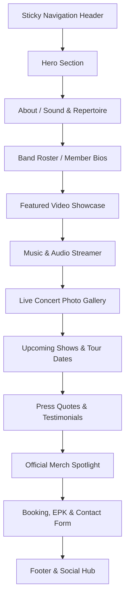

# Southbound — Content Map & Website Architecture Plan

**Document:** `CONTENT_MAP.md`  
**Date:** October 12, 2026  
**Auditor & Architect:** Antigravity AI  
**Project:** Professional, Modern Single-Page Scrolling Website for **Southbound**  
**Design Reference Benchmarks:**  
- [Duff McKagan Official Site](https://duffmckagan.com/) (Gritty rock aesthetic, bold typography, video showcase, merch cards, dark textures)  
- [Van Morrison Official Site](https://vanmorrison.com/) (Refined dark UI, tour date schedule, audio streaming bar, community subscription)  
- [Southbound Live EPK](https://epk.sb916.com/) (Existing electronic press kit, testimonials, show records)  

---

## 1. Website Structure Overview

To meet modern web standards and draw inspiration from the reference benchmarks (Duff McKagan and Van Morrison), the website will be structured as a **seamless, high-impact single-page scrolling experience** with smooth navigation anchors, rich micro-interactions, dark rock aesthetics, and sticky navigation.

---

## 2. Section-by-Section Content Mapping

### Section 1: Sticky Navigation Header (`#header`)
- **Visual Assets:**
  - `Southbound logo - fade-v2.png` (Transparent brand wordmark in navbar)
  - `Southbound Logo - Round.png` (Browser favicon and mobile drawer icon)
- **Navigation Links (Smooth Scroll Anchors):**
  - About (`#about`)
  - The Band (`#band`)
  - Video (`#video`)
  - Music (`#music`)
  - Photos (`#photos`)
  - Shows (`#shows`)
  - Press (`#press`)
  - Merch (`#merch`)
  - Booking & Contact (`#booking`)
- **Quick Action Buttons:**
  - "Book the Band" (High-visibility accent button jumping to `#booking`)
  - Direct Social Icons: Facebook & YouTube

---

### Section 2: Hero Section (`#hero`)
*Inspired by Duff McKagan's bold typography and Van Morrison's atmospheric stage hero.*
- **Visual Asset:**
  - Primary Background / Stage Showcase: `sb_promo25_CLR.jpg` (Official 2025 color promotional composite with full 6-member lineup).
  - Background Texture / Dark Overlay: High-contrast vignette with subtle rock smoke/grunge styling.
- **Text Content:**
  - **Main Headline:** `SOUTHBOUND`
  - **Sub-Headline / Tagline:** *Northern California's Premier Southern Rock Revue*
  - **Badge / Slogan:** *"A Southern Rock Revue & Concert Experience"*
- **Call-to-Action (CTA) Group:**
  - Primary CTA: **"Watch Live Promo"** (Smooth scroll or modal trigger for YouTube promo video)
  - Secondary CTA: **"Book for Your Event"** (Anchor to `#booking`)
- **Streaming & Social Bar:**
  - Quick badges for Facebook (`facebook.com/Southbound6`) and YouTube (`@southbound2102`).

---

### Section 3: About & Sound Repertoire (`#about`)
- **Visual Assets:**
  - Live Stage Backdrop: `SB_04.jpg` / `SB_Downtown Roseville_20230725_01.jpg` (Full band on stage under blue concert lights).
  - Secondary Accent: `Southbound logo - all black-v2.jpg` (Graphic badge).
- **Extracted Text Content (from `Bio_Southbound_m.doc` & `Introduction_Southbound_t.doc`):**
  - *"Southbound is Northern California's premier Southern Rock Revue, performing regularly throughout Northern California and the Greater Sacramento/Sierra area since 2018."*
  - *"The band features a wide variety of Southern Rock classics with a lively stage show and an upbeat, danceable sound perfect for audiences of all ages."*
- **Repertoire / Artist Badges (Interactive Pills / Tags):**
  - The Allman Brothers Band
  - Lynyrd Skynyrd
  - .38 Special
  - The Marshall Tucker Band
  - Molly Hatchet
  - ZZ Top
  - The Outlaws
  - Wet Willie
- **Key Performance Formats:**
  - 6-Piece Full Band
  - Up to 4 Sets (45–60 min per set)
  - Festivals, Park Concerts, Clubs, Corporate Events, MC Rallies, Private Affairs

---

### Section 4: The Band — Member Profiles (`#band`)
*Dedicated 6-card interactive grid showcasing each band member with their verified headshot and extracted biography.*

| Member Name | Role & Instruments | Extracted Biography Summary | Photo Asset |
| :--- | :--- | :--- | :--- |
| **Scott Baxter** | Lead Vocals | Multi-instrumentalist and veteran of hundreds of shows along the Texas Gulf Coast, including performances with rock and roll pioneer Bo Diddley and South Texas blues legend Rocky Benton. Face of Southbound since 2023. | Stage portrait (black hat, sunglasses, vest, holding mic) |
| **Dean Fisher** | Guitars & Vocals | Inspired by the release of "Freebird" nearly 50 years ago. Longtime musical partner with Mike Cochran; co-founded Savannah Blue (Nor Cal's premier Southern Rock Review 28 years ago) and transitioned to Southbound. | Stage portrait (silver hair, full white beard, Stratocaster) |
| **Mike Cochran** | Bass Guitar & Vocals | Started bass at 15. Decades of collaboration with Dean Fisher from backyard BBQs to Savannah Blue and Southbound. Quote: *"I been very fortunate to have played with a lot of incredible musicians and learned so much from every one of them."* | Stage portrait (cowboy hat, sunglasses, white goatee, bass) |
| **Rusty Chain** *(Michael Shreiber)* | Guitar & Vocals | Raised outside Washington DC in a vibrant Blues/Rock scene (Danny Gatton, Jimmy Thackery). Played throughout MD/DC/VA before moving to Sacramento in the late 90s, forming Chain-Lightning Band and Bad Catz. Gritty, blues-soaked riffs. | Stage portrait (straw hat, white sleeveless shirt, guitar) |
| **Tony Vivilacqua** | Drums & Vocals | Began drumming at 11 on Folgers coffee cans before getting his first drum kit from the Auburn Journal classifieds. Playing professionally by 16; influenced by KZAP classic rock, Lynyrd Skynyrd, and Allman Brothers. | Stage portrait (smiling at drum kit under red stage lighting) |
| **Larry Audino** | Keyboards, Guitar & Vocals | Began piano at 10 and picked up guitar for travel before returning to advanced keyboards at 19. Longtime core member of Savannah Blue and now integral to Southbound's rich signature Hammond organ/piano sound. | Stage portrait (sunglasses, t-shirt, playing electronic keyboards) |

---

### Section 5: Featured Video Showcase (`#video`)
*Modeled after the video slider on Duff McKagan's website with custom thumbnail overlays and play triggers.*
- **Primary Video Feature:**
  - Video Title: **"Southbound Official Promotional Video"**
  - YouTube Video URL: `https://www.youtube.com/watch?v=UlN5942NNu8` (Promo Reel dedicated in memory of late singer Jack James)
  - Embed Type: Responsive 16:9 YouTube iframe player with custom play poster.
- **Secondary Video Carousel / Links (Extracted from `@southbound2102` & EPK):**
  - Cover: *"Keep on Smilin'"* (Wet Willie cover)
  - Cover: *"What If I'd Been The One"* (.38 Special cover)
  - Promo Reel: *"Southbound Promo Video '25"*
  - Direct Link Button: **"Visit Southbound on YouTube"** (`https://www.youtube.com/@southbound2102`)

---

### Section 6: Music & Audio Player (`#music`)
*Inspired by Van Morrison's streaming bar and media cards.*
- **Audio Tracks Available on Live EPK:**
  1. **"Can't You See"** — Marshall Tucker Band Cover (6:50)
  2. **"Midnight Rider"** — The Allman Brothers Band Cover (3:05)
  3. **"There Goes Another Love Song"** — The Outlaws Cover (2:59)
- **Website Implementation:**
  - Stylized custom HTML5 Audio Player interface with waveform visualization / play-pause-scrub controls.
  - Streaming links & external audio service embed (or direct host if files are provided).
  - Prominent notice/prompt for visitors to experience the live sound.

---

### Section 7: Live Concert Photo Gallery (`#photos`)
*Dynamic masonry / filterable image gallery utilizing the client's extensive concert collection.*
- **Available High-Resolution Assets (40+ concert images):**
  - **Outdoor Festivals:** Roseville Concert Series (`South Bound 7-25- 2023_...` series — 22 photos up to 24MP), Robb's Resort (`20250705_RobbsResortFinale.jpg`, `01.jpg`), Rocklin (`SB_Rocklin_20250603_13.jpg`).
  - **Indoor Theatre & Historic Venues:** Opera House Series (`sb_operahouse_20240329_...` and `20250523_...` — 7 photos).
  - **Riverfront & Summer Stages:** Swabbies on the River (`sb_swabbies_20250621_12.jpg`, `sb_swabbies_20260328_45.jpg`).
  - **Club & Pub Gigs:** Corner Pocket Sports Bar (`sb_20250216_CornerPocket01.jpg`).
  - **Candid & Backstage:** Swabbies band selfie (`sb_20250621_Swabbies_Selfie02.jpg`).
- **Interactive Features:**
  - Category Filter Buttons: *All Photos*, *Festivals & Parks*, *Opera House*, *Live Action*, *Backstage*.
  - Lightbox / Fullscreen Viewer modal for high-res viewing.

---

### Section 8: Tour Dates & Upcoming Shows (`#shows`)
*Inspired by Van Morrison's clean tabular show list with date badges, venue names, location, and ticket/info links.*
- **Extracted Tour & Show History:**
  - **Upcoming Highlights (from EPK):**
    - High Hand Brewery & Garden — Loomis, CA (October 12)
    - Powerhouse Pub — Folsom, CA (December 19)
  - **Signature Venues & Festivals (from `Introduction_Southbound_t.doc` & EPK):**
    - Roseville Concert in the Park — Roseville, CA
    - Carmichael Park Concert Series — Carmichael, CA
    - Vacaville Tomato & Vine Festival — Vacaville, CA
    - Swabbies on the River — Sacramento, CA
    - Historic Opera House — Northern California
    - Winnemucca Convention Center — Winnemucca, NV
    - Robb's Resort — Sierra Foothills, CA
- **Interactive Component:**
  - Live Gig Calendar cards with "Add to Calendar" / "Venue Info" / "Book Tickets" buttons.
  - Callout banner: *"Want Southbound at your festival, park, or venue? Inquire below for booking availability."*

---

### Section 9: Press Quotes & Reviews (`#press`)
*High-credibility testimonials from radio personalities and event coordinators.*
- **Extracted Testimonials (from live EPK):**
  > **"Southbound is Southern Rock done right! A live jukebox of classic rock hits, played with true arena-rock energy! Great vocals, great guitars, tight rhythm section, and killer keyboards! You will love the Southern Rock experience!"**  
  > — **Doug Thomas**, Radio Personality, *96.9 The Eagle (Sacramento, CA)*
  
  > **"This band is great! Their catalog of Southern Rock/Classic Rock hits are always well produced and presented with talent and heart."**  
  > — **Darrel Field**, Marketing & Events Coordinator, *Winnemucca Convention & Visitors Authority*
- **Layout:**
  - Modern quote carousel / dual testimonial cards with quotation typography and radio station / municipal logos.

---

### Section 10: Official Merchandise Spotlight (`#merch`)
*Inspired by the Official Store grids on Duff McKagan's website.*
- **Visual Asset:**
  - `SB artwork 08 tshirt.png` (Vintage psychedelic concert artwork with guitars, steam train, motorcycle, and *"What song is it you wanna hear?"*).
- **Merchandise Features:**
  - Official Tour T-Shirt Showcase card.
  - Band Stickers, Patches, and Memorabilia spotlight.
  - "Inquire / Available at Shows" badge (since no external e-commerce store link was provided in the folder).

---

### Section 11: Booking, EPK & Contact (`#booking`)
- **Booking Copy (from `Introduction_Southbound_t.doc`):**
  - Professional pitch tailored for event coordinators, talent buyers, and venue managers.
  - Information regarding set lengths, stage requirements, and production readiness.
- **Direct Contacts (Extracted):**
  - **Booking Agent / Manager:** Michael Shreiber (Rusty) — `916.804.0723` | `Rusty@SB916.com`
  - **Band Contact:** Tony Vivilacqua — `916.997.1176` | `SouthboundEmail@Gmail.com`
  - **General Inquiries:** `Booking@SB916.com`
- **Interactive Booking Form:**
  - Name, Email, Phone, Event Date, Event Type (Festival, Club, Private Party, Corporate, Rally), Venue Location, Message.
- **EPK Quick Downloads (Buttons):**
  - Link to full Electronic Press Kit: `https://epk.sb916.com/`

---

### Section 12: Footer & Social Hub (`#footer`)
- **Visual Emblem:** `Southbound Logo - Round.png` (Circular emblem)
- **Social Links:**
  - Facebook: `https://www.facebook.com/Southbound6`
  - YouTube: `https://www.youtube.com/@southbound2102`
- **Copyright & Credits:**
  - *"© 2026 Southbound. All rights reserved. Northern California's Premier Southern Rock Revue."*
  - Fast back-to-top scroll button.

---

## 3. Supply Gap Analysis & Action Items

| Category | Assets Available | Missing / Unresolved Items | Client Action Required |
| :--- | :--- | :--- | :--- |
| **Audio** | 0 files in local `_Audio/` | High-fidelity master audio tracks (MP3/WAV) | Provide 320kbps MP3s or authorize embedding third-party audio player from EPK. |
| **Video** | YouTube URL `UlN5942NNu8` | Native MP4 video files for background video | Confirm use of YouTube embedded player or supply raw MP4 clip for hero background loop. |
| **PDF Press Kit** | Text documents (`.doc`) provided | Downloadable PDF files (`Southbound_EPK.pdf`, `Southbound_Bio.pdf`, stage plot rider) | Provide export of press kit PDFs for download links. |
| **Gig Calendar** | 2 upcoming dates & 18 past dates on EPK | Master schedule of 2026/2027 confirmed tour dates | Supply latest list of upcoming tour dates and ticket URLs. |
| **Primary Email** | 3 emails found (`Rusty@SB916.com`, `SouthboundEmail@Gmail.com`, `Booking@SB916.com`) | Official public inquiry destination | Confirm which email address should receive website booking form submissions. |
| **Merchandise Shop** | T-shirt artwork PNG provided | Direct e-commerce store URL (Shopify/Square/Printful) | Confirm whether merchandise is sold online or exclusively at live shows. |
