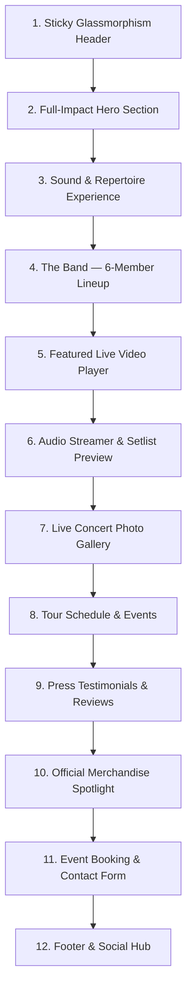

# Southbound Band Website — Design & Implementation Plan

**Document:** `WEBSITE_PLAN.md`  
**Date:** October 12, 2026  
**Auditor & Lead Architect:** Antigravity AI  
**Client Project:** Southbound Band Official Website  
**Format:** Polished, Modern, Single-Page Scrolling Website  
**Workspace:** `d:\Antigravity Project\Rusty Chain`  
**Reference Benchmarks:**  
- [Duff McKagan Official Site](https://duffmckagan.com/) (Rock attitude, bold typography, featured video integration, dark grit, merch showcase)  
- [Van Morrison Official Site](https://vanmorrison.com/) (Refined dark aesthetic, generous spacing, prestigious tour dates table, audio streaming, press authority)  
- [Southbound Live EPK](https://epk.sb916.com/) (Live electronic press kit, testimonials, verified gig history)  

---

## 1. Executive Vision & Creative Direction

### 1.1. Core Identity & Philosophy
**Southbound** is Northern California’s premier Southern Rock Revue—a powerhouse 6-piece ensemble delivering the danceable, arena-rock energy of Lynyrd Skynyrd, the Allman Brothers, .38 Special, and the Marshall Tucker Band.

The website must feel like a **headline music-industry destination**, not a generic local band page or corporate landing page:
1. **Band Photography First:** The band has exceptional assets—including ultra-high-resolution 24-megapixel Nikon D780 outdoor concert photography, full-lineup promotional composites, and historic theatre stage shots. Imagery will drive the storytelling.
2. **Atmospheric Dark Rock Aesthetic:** Inspired by Duff McKagan’s rock authenticity and Van Morrison’s sophisticated dark interface, the design blends deep charcoal and raw asphalt backgrounds with warm sunburst amber/bourbon accents (evoking vintage Les Paul sunbursts, stage lights, and Southern warmth).
3. **Restrained, Intentional Motion:** Subtle micro-interactions, smooth scroll anchors, elegant image fades, and interactive audio/video players that enhance user delight without distracting from the music.
4. **Zero Fluff / 100% Real Content:** Every bio, photo, quote, contact number, and video link stems directly from the client’s verified content assets.

---

## 2. Design System & Visual Specification

### 2.1. Color Palette

```
/* Primary Foundations */
--color-bg-base:        #0c0c0e;   /* Deep charcoal-black background */
--color-bg-surface:     #141418;   /* Elevated surface cards and containers */
--color-bg-surface-elev:#1b1b22;   /* Hover cards, modals, and drop-downs */
--color-border-subtle:  #262630;   /* Clean separation lines */
--color-border-strong:  #3d3d4d;   /* Active borders and inputs */

/* Brand & Harmonic Accents */
--color-accent-gold:    #e5a947;   /* Warm sunburst amber / California golden hour */
--color-accent-amber:   #c67d26;   /* Rich bourbon / stage spotlight warmth */
--color-accent-blue:    #1c4da1;   /* Logo brand blue (from original logo header) */
--color-accent-glow:    rgba(229, 169, 71, 0.15); /* Subtle glow for buttons & highlights */

/* Typography & Contrast */
--color-text-primary:   #f5f4f0;   /* High-contrast off-white / parchment */
--color-text-secondary: #a8a7b0;   /* Legible silver-gray for paragraphs & metadata */
--color-text-muted:     #6a6974;   /* Captions, timestamps, and subtle credits */
```

### 2.2. Typography System
* **Display / Headings:** **`Oswald`** (Google Fonts)  
  * Condensed, impactful, and authoritative rock lettering reminiscent of classic festival posters and modern rock artist web typography (Duff McKagan benchmark).  
  * Scales: `clamp(2.5rem, 6vw, 4.5rem)` for Hero headline; `2.0rem – 2.75rem` for Section titles; uppercase styling with `0.05em` letter spacing.
* **Secondary Display / Subtitles:** **`Cinzel`** or **`Playfair Display`** (Google Fonts)  
  * Elegant serif used sparingly for taglines (e.g., *"Northern California’s Premier Southern Rock Revue"*) to echo the filigree and Western-revue heritage of their official logo.
* **Body & UI Text:** **`Plus Jakarta Sans`** or **`Inter`** (Google Fonts)  
  * Modern, geometric, clean readability across all mobile and desktop viewports.  
  * Base: `16px / 1.65` line height for effortless reading.

### 2.3. Spatial Cadence & UI Elements
* **Section Padding:** Generous `100px 0` desktop, `64px 0` mobile (avoiding cramped layouts).
* **Container Width:** `1240px` max-width with responsive fluid gutters (`24px` mobile, `48px` desktop).
* **Buttons:**
  * **Primary Action:** Solid warm amber (`#e5a947`) with dark text (`#0c0c0e`), bold uppercase tracking, smooth hover lift, and subtle gold shadow.
  * **Secondary / Outline Action:** Transparent background with subtle border (`#3d3d4d`), hovering to white with gold border accent.
* **Separators:** Weathered hairline rules with centered guitar-pick star icons (`★`) derived from the official logo badge.

---

## 3. Proposed Page Architecture & Section Breakdown

The site will flow seamlessly down a single-page continuous scroll with 11 purposeful sections:



---

### Section 1: Sticky Navigation Header (`#header`)
* **Layout:** Fixed top bar with glassmorphism blur (`backdrop-filter: blur(12px); background: rgba(12, 12, 14, 0.88)`), subtle bottom border.
* **Left:** Brand wordmark using [Southbound logo - fade-v2.png](file:///d:/Antigravity%20Project/Rusty%20Chain/Southbound%20Materials/Southbound%20logo%20-%20fade-v2.png) (height `42px`), clicking scrolls to `#hero`.
* **Center (Desktop):** Smooth-scrolling anchor links:
  * `About` | `The Band` | `Video` | `Music` | `Photos` | `Shows` | `Press` | `Merch` | `Booking`
* **Right:**
  * Quick Social Icons: Facebook & YouTube
  * Accent CTA Button: **"Book Now"** (jumps directly to `#booking`)
* **Mobile Viewport:** Responsive hamburger menu opening an animated full-screen drawer with large touch-friendly links and circular band emblem.

---

### Section 2: Hero Section (`#hero`)
*Inspired by Duff McKagan's striking opening presence and Van Morrison's cinematic scale.*
* **Visual Asset:** Full-width background showcase utilizing the official 2025 promotional composite [sb_promo25_CLR.jpg](file:///d:/Antigravity%20Project/Rusty%20Chain/Southbound%20Materials/sb_promo25_CLR.jpg) with a refined radial vignette and bottom gradient bleed to ensure contrast.
* **Headline:**
  * Top Eyebrow: `A SOUTHERN ROCK REVUE & CONCERT EXPERIENCE`
  * Main Title: `SOUTHBOUND` (Giant high-contrast display typography with subtle textured depth)
  * Sub-Headline: `Northern California's Premier Southern Rock Revue`
* **Action Group:**
  * Primary Button: **"Watch Live Promo"** (Smoothly scrolls to video section and triggers play, or launches embedded modal)
  * Secondary Button: **"Check Tour Dates"** (Scrolls to `#shows`)
  * Secondary Link: **"Book the Band"** (Scrolls to `#booking`)
* **Live Status Bar:**
  * Quick pill badges: `6-Piece Full Band` • `Sacramento / Sierra / NorCal` • `High Energy Stage Show`

---

### Section 3: About the Band & The Sound Experience (`#about`)
* **Layout:** Two-column split layout on desktop; single column on mobile.
* **Left Column:**
  * Live stage photograph under vibrant concert illumination ([SB_04.jpg](file:///d:/Antigravity%20Project/Rusty%20Chain/Southbound%20Materials/_Images/SB_04.jpg) / [SB_Downtown Roseville_20230725_01.jpg](file:///d:/Antigravity%20Project/Rusty%20Chain/Southbound%20Materials/_Images/SB_Downtown%20Roseville_20230725_01.jpg)).
  * Floating badge: `"Performing across Northern California since 2018"` with the circular logo emblem.
* **Right Column (Copy extracted from client `.doc` files):**
  * **Header:** *"The Pure Energy of Southern Rock"*
  * **Lead Text:** *"Southbound is Northern California's premier Southern Rock Revue. We deliver the driving rhythms, twin-lead guitar harmonies, and soulful vocals of the genre's golden era with an upbeat sound perfect for dancing and audiences of all ages."*
  * **Repertoire Highlights (Pill Badges):**
    * The Allman Brothers Band
    * Lynyrd Skynyrd
    * .38 Special
    * The Marshall Tucker Band
    * Molly Hatchet
    * ZZ Top
    * The Outlaws
    * Wet Willie
  * **Format Specs Card:**
    * 6-piece full band configuration
    * Up to 4 sets (45–60 minutes per set)
    * Accustomed to large festival audiences, concerts in the park, rallies, and premier live music clubs.

---

### Section 4: The Band — 6-Member Roster (`#band`)
*Dedicated member spotlight featuring authentic bios and stage headshots for all 6 members.*
* **Grid Layout:** 3 columns × 2 rows on desktop; 2 columns on tablet; 1 column on mobile.
* **Member Cards:**
  1. **Scott Baxter** — *Lead Vocals*
     * Photo: Stage portrait in black hat, sunglasses, vest, holding mic.
     * Bio: Multi-instrumentalist and veteran of hundreds of shows along the Texas Gulf Coast, including gigs with Bo Diddley and Rocky Benton. Face of Southbound since 2023.
  2. **Dean Fisher** — *Guitars & Vocals*
     * Photo: Stage portrait with long silver hair, full white beard, Stratocaster.
     * Bio: Inspired by the release of *Freebird* nearly 50 years ago. Longtime collaborator with Mike Cochran; co-founded *Savannah Blue* 28 years ago and brought that brotherhood into Southbound.
  3. **Mike Cochran** — *Bass Guitar & Vocals*
     * Photo: Stage portrait in brown cowboy hat, sunglasses, white goatee, playing bass.
     * Bio: Began playing bass at 15. Formed *Savannah Blue* with Dean Fisher; 28 years later, morphing those Southern Rock influences into Southbound.
  4. **Rusty Chain** *(Michael Shreiber)* — *Guitar & Vocals*
     * Photo: Stage portrait in straw cowboy hat, white sleeveless shirt, playing electric guitar.
     * Bio: Immersed in the D.C./Maryland/Virginia blues-rock scene (Danny Gatton, Jimmy Thackery). Formed Chain-Lightning and Bad Catz in Sacramento. Delivers gritty, blues-soaked riffs.
  5. **Tony Vivilacqua** — *Drums & Vocals*
     * Photo: Stage portrait smiling behind drum kit under red stage lights.
     * Bio: Began at 11 on Folgers coffee cans before getting a $25 drum set from Auburn Journal classifieds. Professional at 16; influenced by KZAP classic rock, Skynyrd, and Allman Brothers.
  6. **Larry Audino** — *Keyboards, Guitar & Vocals*
     * Photo: Stage portrait playing electronic keyboard in brown t-shirt.
     * Bio: Started piano at 10, picked up guitar for portability, returned to keyboards at 19. Integral founding member of *Savannah Blue* and the harmonic spine of Southbound.

---

### Section 5: Featured Video Showcase (`#video`)
*Modeled on Duff McKagan's custom video section with dark cinematic framing.*
* **Primary Feature:** Embedded responsive 16:9 player for the official Southbound promotional video:
  * URL: `https://www.youtube.com/watch?v=UlN5942NNu8` (Promo Reel dedicated in memory of late singer Jack James)
  * Feature: Custom play button poster, lazy-loading for fast page speeds, cinema-mode styling.
* **Channel Highlights & Covers Carousel:**
  * *"Keep on Smilin'"* (Wet Willie cover)
  * *"What If I'd Been The One"* (.38 Special cover)
  * *"Southbound Promo Video '25"*
* **Channel Button:** Direct link to YouTube channel: `https://www.youtube.com/@southbound2102`.

---

### Section 6: Music & Sound Experience (`#music`)
*Inspired by Van Morrison's streaming bar and audio cards.*
* **Overview:** Showcases the band’s audio identity featuring their three signature cover recordings (as featured on their EPK):
  1. **"Can't You See"** — Marshall Tucker Band cover (6:50)
  2. **"Midnight Rider"** — The Allman Brothers Band cover (3:05)
  3. **"There Goes Another Love Song"** — The Outlaws cover (2:59)
* **Custom Audio Player Interface:**
  * Clean dark-mode HTML5 audio player widget with track selector, play/pause controls, time display, progress scrubber, and volume control.
  * Link to full recordings and EPK streaming tracks.

---

### Section 7: Live Concert Photo Gallery (`#photos`)
*Showcasing the client's collection of 40+ high-resolution concert photos.*
* **Interactive Filter Tabs:**
  * `All Photos` | `Festivals & Parks` | `Opera House Stage` | `Club & Pub Gigs` | `Backstage & Candid`
* **Curated Gallery Highlights:**
  * **Outdoor Festivals:** Roseville Concert Series (`South Bound 7-25- 2023_...` series), Robb's Resort Finale (`20250705_RobbsResortFinale.jpg`), Rocklin (`SB_Rocklin_20250603_13.jpg`).
  * **Historic Theatre:** Opera House concert series (`sb_operahouse_20240329_...` & `20250523_...`).
  * **Riverfront Shows:** Swabbies on the River (`sb_swabbies_20250621_12.jpg`, `sb_swabbies_20260328_45.jpg`).
  * **Club Nights:** Corner Pocket Sports Bar (`sb_20250216_CornerPocket01.jpg`).
  * **Backstage Moments:** Swabbies band selfie (`sb_20250621_Swabbies_Selfie02.jpg`).
* **Lightbox Viewer:** Custom lightweight JavaScript modal allowing visitors to click any photo, browse full-screen, and view venue/date captions with keyboard navigation (Esc, Arrow Left/Right).

---

### Section 8: Tour Dates & Live Shows (`#shows`)
*Inspired by Van Morrison's high-clarity upcoming shows table.*
* **Layout:** Clean list layout with stylized date badges, venue names, location, and action buttons.
* **Confirmed & Upcoming Dates (from EPK):**
  * **OCT 12** — High Hand Brewery & Garden • *Loomis, CA* [Event Details]
  * **DEC 19** — Powerhouse Pub • *Folsom, CA* [Event Details]
* **Premier Past Festivals & Venues (Credibility Showcase):**
  * Roseville Concert in the Park • *Roseville, CA*
  * Carmichael Park Concerts in the Park • *Carmichael, CA*
  * Vacaville Tomato & Vine Festival • *Vacaville, CA*
  * Swabbies on the River • *Sacramento, CA*
  * Robb's Resort Sierra Finale • *Pollock Pines, CA*
  * Winnemucca Convention Center • *Winnemucca, NV*
* **Booking Callout Banner:**
  * *"Planning a festival, concert in the park, or private event? Southbound books up fast for summer and fall dates."*  
  * Button: **"Inquire About Booking"** (smooth scrolls to `#booking`).

---

### Section 9: Press Quotes & Reviews (`#press`)
*Prominently features verified industry praise from radio and event professionals.*
* **Testimonial Cards:**
  * **Quote 1 (Radio):**
    > *"Southbound is Southern Rock done right! A live jukebox of classic rock hits, played with true arena-rock energy! Great vocals, great guitars, tight rhythm section, and killer keyboards! You will love the Southern Rock experience!"*  
    > **— Doug Thomas**, Radio Personality, **96.9 The Eagle (Sacramento, CA)**
  * **Quote 2 (Festival Organizer):**
    > *"This band is great! Their catalog of Southern Rock/Classic Rock hits are always well produced and presented with talent and heart."*  
    > **— Darrel Field**, Marketing & Events Coordinator, **Winnemucca Convention & Visitors Authority**
* **Styling:** Elegant quotation marks, gold attribution rules, high credibility typography.

---

### Section 10: Official Merchandise Spotlight (`#merch`)
*Inspired by the Official Store product grids on Duff McKagan's website.*
* **Featured Asset:** [SB artwork 08 tshirt.png](file:///d:/Antigravity%20Project/Rusty%20Chain/Southbound%20Materials/_Images/SB%20artwork%2008%20tshirt.png) (Vibrant psychedelic concert graphic).
* **Product Showcase:**
  * **"What Song Is It You Wanna Hear?" Tour T-Shirt:** Full color high-detail mock card.
  * **Official Band Badges & Stickers:** Featuring the round logo emblem.
  * **Purchase Info:** *"Official merchandise is available exclusively at all Southbound live performances and festivals. Stop by the merch table at the next show!"*

---

### Section 11: Event Booking & Contact Form (`#booking`)
*A dedicated booking portal tailored for event organizers, talent buyers, and fans.*
* **Left Column — Direct Booking Contacts (Extracted):**
  * **Michael Shreiber (Rusty) — Booking & Management:**  
    📞 Phone: `(916) 804-0723`  
    ✉️ Email: `Rusty@SB916.com`
  * **Tony Vivilacqua — Band Contact:**  
    📞 Phone: `(916) 997-1176`  
    ✉️ Email: `SouthboundEmail@Gmail.com`
  * **General Booking:** `Booking@SB916.com`
  * **Press Kit Downloads Button:** Direct link to online EPK (`https://epk.sb916.com/`).
* **Right Column — Interactive Booking & Inquiry Form:**
  * Fields:
    * Full Name *(Required)*
    * Email Address *(Required)*
    * Phone Number *(Optional)*
    * Event Type *(Select: Festival / City Concert, Club / Music Venue, Private Party, Corporate Event, MC / Car Rally)*
    * Proposed Date *(Date picker)*
    * Venue / City Location
    * Message / Event Details *(Required)*
  * Action: **"Send Booking Inquiry"** button with loading feedback and submission confirmation state.

---

### Section 12: Footer & Social Hub (`#footer`)
* **Visual Identity:** Centered circular logo [Southbound Logo - Round.png](file:///d:/Antigravity%20Project/Rusty%20Chain/Southbound%20Materials/Southbound%20Logo%20-%20Round.png) (size `80px`).
* **Social Links:**
  * Facebook: `https://www.facebook.com/Southbound6`
  * YouTube: `https://www.youtube.com/@southbound2102`
* **Navigation Quick Links:** Smooth scroll anchors back to all sections.
* **Copyright & Credits:**
  * *"© 2026 Southbound. All rights reserved. Northern California's Premier Southern Rock Revue."*
  * Smooth Back-to-Top button (`↑ Back to top`).

---

## 4. Asset Mapping Table

Every section is mapped directly to client assets from the workspace:

| Website Section | Element / Component | Asset File Path | Format / Dimensions |
| :--- | :--- | :--- | :--- |
| **Header** | Navbar Logo | `Southbound Materials/Southbound logo - fade-v2.png` | PNG (Transparent, 1080×566) |
| **Header & Tab** | Browser Favicon | `Southbound Materials/Southbound Logo - Round.png` | PNG (612×612) |
| **Hero** | Background Composite | `Southbound Materials/sb_promo25_CLR.jpg` | JPEG (3300×1878) |
| **About** | Live Stage Photo | `Southbound Materials/_Images/SB_04.jpg` | JPEG (1080×706) |
| **About** | Secondary Logo Badge | `Southbound Materials/Southbound logo - all black-v2.jpg` | JPEG (2700×1322) |
| **Band** | Scott Baxter Portrait | Headshot extracted from `Bio_Southbound_m.doc` | JPEG (Portrait) |
| **Band** | Dean Fisher Portrait | Headshot extracted from `Bio_Southbound_m.doc` | JPEG (Portrait) |
| **Band** | Mike Cochran Portrait | Headshot extracted from `Bio_Southbound_m.doc` | JPEG (Portrait) |
| **Band** | Rusty Chain Portrait | Headshot extracted from `Bio_Southbound_m.doc` | JPEG (Portrait) |
| **Band** | Tony Vivilacqua Portrait | Headshot extracted from `Bio_Southbound_m.doc` | JPEG (Portrait) |
| **Band** | Larry Audino Portrait | Headshot extracted from `Bio_Southbound_m.doc` | JPEG (Portrait) |
| **Video** | Main Promo Embed | `https://www.youtube.com/watch?v=UlN5942NNu8` | YouTube Video ID `UlN5942NNu8` |
| **Gallery** | Outdoor Festival Photos | `Southbound Materials/_Images/South Bound 7-25- 2023_...` | 22 high-res JPEGs (up to 24MP) |
| **Gallery** | Opera House Photos | `Southbound Materials/_Images/sb_operahouse_...` | 7 JPEGs (Various dates) |
| **Gallery** | Swabbies River Photos | `Southbound Materials/_Images/sb_swabbies_...` | 2 JPEGs |
| **Gallery** | Robb's Resort Finale | `Southbound Materials/_Images/20250705_RobbsResortFinale.jpg` | JPEG (2048×1152) |
| **Gallery** | Corner Pocket Club | `Southbound Materials/_Images/sb_20250216_CornerPocket01.jpg` | JPEG (2048×1343) |
| **Gallery** | Backstage Selfie | `Southbound Materials/_Images/sb_20250621_Swabbies_Selfie02.jpg` | JPEG (960×720) |
| **Merch** | Tour T-Shirt Art | `Southbound Materials/_Images/SB artwork 08 tshirt.png` | PNG (1643×2000) |
| **Footer** | Circular Emblem | `Southbound Materials/Southbound Logo - Round.png` | PNG (612×612) |

---

## 5. Technology Stack & Deployment Architecture

To ensure maximum reliability, instant loading, long-term stability, and zero maintenance friction, the recommended architecture is:

### 5.1. Core Tech Stack
* **Markup (HTML5):** Semantic, accessible HTML5 (`<header>`, `<nav>`, `<main>`, `<section>`, `<article>`, `<footer>`).
* **Styling (Vanilla CSS3):**
  * Modern CSS Custom Properties (Tokens for colors, spacing, typography).
  * Flexbox and CSS Grid for layout without bulky framework bloat.
  * Native CSS smooth scrolling (`scroll-behavior: smooth; scroll-padding-top: 80px`).
  * Optimized CSS media queries (`mobile-first` responsive breakpoints at `640px`, `960px`, `1200px`).
* **Interactions (Vanilla JavaScript, ES6+):**
  * Zero external JS dependencies (no jQuery, no heavy frameworks).
  * Smooth scroll navigation with active section highlighting via `IntersectionObserver`.
  * Mobile drawer menu toggle with accessible ARIA attributes.
  * Lightweight, accessible photo gallery lightbox modal with touch swipe and keyboard controls.
  * Lazy-loading for high-resolution images (`loading="lazy"`) and YouTube iframe facade (facade thumbnail that only initializes the player upon user click to keep initial load < 1 second).

### 5.2. Asset Optimization Strategy
The client images are up to 21 MB each (24-megapixel Nikon RAW exports). To achieve a sub-second page load:
* Generate web-optimized responsive renditions (`WebP` / optimized `JPEG` at `1920px` max desktop, `800px` mobile) while keeping the original files 100% untouched in `Southbound Materials/`.
* High-res originals remain linked for full-screen modal viewing.

---

## 6. Contact Form Implementation Options (Zero Security Leaks)

The user requirement states: *The contact form must eventually send submissions to the client's email. Do not expose API keys or email credentials in frontend code.*

Here are three reliable implementation options:

| Option | Method | Security & Leak Prevention | Pros | Best For |
| :--- | :--- | :--- | :--- | :--- |
| **Option A (Recommended)** | **Serverless Form Gateway** (e.g. Formspree / Web3Forms) | Public form endpoint ID only; no passwords, API keys, or SMTP secrets in code. Target emails (`Rusty@SB916.com`, `Booking@SB916.com`) are configured securely in the gateway dashboard. | Instant AJAX submission, automatic spam filtering (Honeypot + reCAPTCHA), zero server maintenance, email notification sent directly to band. | Production deployment on any static host. |
| **Option B** | **Netlify Forms / Cloudflare Pages Forms** | Native platform handling via HTML attribute (`data-netlify="true"`). Zero code, zero API keys. | 100% native, free tier includes 100 submissions/month, instant email alerts to Michael & Tony. | If deployed on Netlify or Cloudflare Pages. |
| **Option C** | **Smart `mailto:` Form Fallback** | Pure frontend submission that compiles form fields into a pre-filled email draft opening directly in the user's default email client (`mailto:Booking@SB916.com?subject=...&body=...`). | 100% offline-ready, zero third-party service dependency, impossible to leak credentials. | Development testing or zero-service environments. |

**Recommended Path:** Implement Option A (with Web3Forms or Formspree endpoint) with Option C as an automatic graceful fallback if JavaScript or network requests are blocked.

---

## 7. Testing & Quality Assurance Strategy

1. **Responsive Testing:**
   * Mobile (375px, 390px, 414px — iPhone & Android)
   * Tablet (768px, 820px — iPad vertical and horizontal)
   * Desktop (1280px, 1440px, 1920px full widescreen)
2. **Navigation & Interaction Testing:**
   * All navbar links jump cleanly to respective sections with correct offset clearance beneath the sticky header.
   * Mobile drawer menu opens, closes, and locks background scroll appropriately.
   * Gallery lightbox opens full resolution, cycles correctly, and closes with `Esc`.
3. **Performance & Lighthouse Auditing:**
   * Lazy load all off-screen images and YouTube iframe.
   * Target Lighthouse scores: **95+ Performance, 100 Accessibility, 100 Best Practices, 100 SEO**.
4. **Cross-Browser Verification:**
   * Chrome, Firefox, Safari (WebKit), Edge.
5. **Form Validation & Security Check:**
   * Validate required fields (Name, Email, Message).
   * Verify email format regex.
   * Verify honeypot anti-spam field prevents automated bot submissions.
   * Verify no private keys, passwords, or SMTP credentials exist in client scripts.
